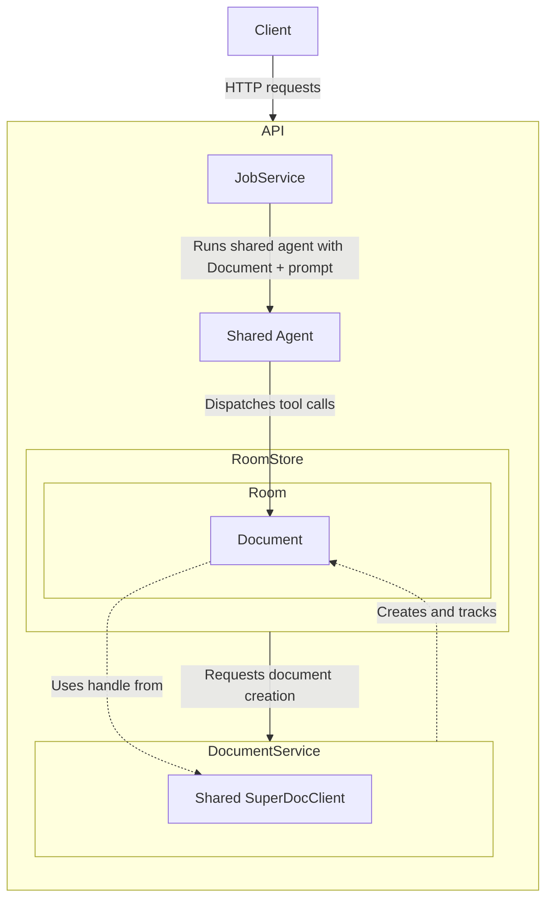

# Collab Load Testing
This repository runs independently of Orbit. It includes its own server,
browser client, load generator, dependency locks, and Docker configuration.

The [keypress diagram](artifacts/keypress-path.html) and
[SVG version](artifacts/keypress-path.svg) are stored under `artifacts/`.
Saved trial captures moved with the project and remain local and ignored.
Absolute report paths were rebased during the move; original metadata is
retained locally in `artifacts/migration-original-metadata/`.

A collaboration load test harness based on the canonical collaboration demo, with a React editor, a Fastify/Hocuspocus backend, and a configurable Playwright runner. It records connected users, active typing, per-keystroke local and remote latency, and annotated document images. The agent chat remains available for manual testing.

## Run the roles separately

| Role | Command | Responsibility |
| --- | --- | --- |
| Server | `npm run server` | Serves the built editor, HTTP API, Hocuspocus, and SDK document runtime |
| Load generator | `npm run load-generator -- ...` | Launches typing browsers, schedules input, and writes reports |
| Observer | `npm run observer -- ...` | Hosts a separate Chromium process controlled through its Playwright endpoint |

Without `--observer-ws`, the generator starts an independent observer worker process automatically. It always uses a different Chromium instance from the writers. Use separate hosts or containers to isolate CPU and memory; separate processes on one laptop still share those resources. The server is started separately and is never launched by the load generator.

### Server machine

```bash
npm run install:all
npm run build
npm run server
```

The built app and API share `http://localhost:8100`. Configure `PORT` and `HOST` through the environment or `.env`. By default, the frontend uses same-origin API and WebSocket URLs, so it works at the server's reachable hostname without rebuilding the browser bundle. Agent chat is optional: setting `OPENAI_API_KEY` enables it; without a key, collaboration tests still run and agent job submissions return `503`.

### Observer machine

```bash
npm ci
npx playwright install --with-deps chromium
npm run observer -- --host 127.0.0.1 --port 3100
```

The observer prints a WebSocket endpoint containing a random access path. To reach it from the generator through SSH:

```bash
ssh -N -L 3100:127.0.0.1:3100 user@observer-host
```

Keep that tunnel open and use the printed endpoint on the generator. For a private network, bind with `--host 0.0.0.0 --public-host observer-host`. The endpoint grants browser control, so keep it on a private network or tunnel. The observer and generator must use the same pinned Playwright version (`1.64.0`). The observer browser must be able to reach the server URL itself; forwarding the observer's control connection does not forward its app traffic.

### Generator machine

```bash
npm ci
npx playwright install --with-deps chromium
npm run load-generator -- \
  --server-url http://server-host:8100 \
  --observer-ws 'COPY-THE-PRINTED-OBSERVER-ENDPOINT' \
  --require-external-observer \
  --document /absolute/path/to/test-document.docx \
  --users 10 \
  --layout first-two-pages \
  --chars-per-second 5
```

`SERVER_URL` and `OBSERVER_WS_URL` are environment alternatives to those endpoint flags. `--require-external-observer` rejects a missing observer endpoint, which prevents an intended distributed run from silently starting an observer on the generator. Reports, raw traces, screenshots, and the final DOCX are collected on the generator. A run releases its browser contexts and connection without stopping an external observer worker, so that worker can serve another run.

The report records role locations and process IDs where available. Browser clocks are calibrated against the generator before and after the run; timestamp mapping interpolates the observed drift. Remote latency includes the combined calibration uncertainty of the writer and observer, with lower/upper estimates in JSON and CSV. This works with different machine clock epochs and does not require matching wall-clock times. Network asymmetry and clock variation limit timing precision; small differences within the reported uncertainty are inconclusive.

### Containers

`Dockerfile` has `server`, `observer`, and `generator` targets. The browser image and npm package pin Playwright to `1.64.0`. `compose.yaml` runs each role in its own container, with shared memory allocated for the two browser roles. Containers on one host provide process separation, not hardware isolation.

```bash
mkdir -p artifacts fixtures
docker compose up --build -d server observer
docker compose logs observer
```

Copy the printed `ws://observer:3100/...` endpoint, then run:

```bash
OBSERVER_WS_URL='COPY-THE-PRINTED-OBSERVER-ENDPOINT' docker compose run --rm generator
```

The default container run uses two writers and the bundled blank DOCX. Place a document in `fixtures/` to make it available read-only under `/fixtures/`, then override the command:

```bash
OBSERVER_WS_URL='COPY-THE-PRINTED-OBSERVER-ENDPOINT' docker compose run --rm generator \
  --server-url http://server:8100 \
  --require-external-observer \
  --document /fixtures/test-document.docx \
  --users 10 --layout first-two-pages
```

The app is available to your browser at `http://localhost:8100`; generated artifacts are saved to the host's `artifacts/` directory. For three machines, build the same targets and use server/observer hostnames reachable from the other roles instead of Compose service names.

## Control Diagram/Hierarchy



The diagram focuses on actions initiated through the HTTP API, such as creating, uploading, downloading, replacing, or deleting a document; submitting or cancelling an agent job; reading job or chat state; and checking room status. Separately, SuperDoc manages the client's connection to the document through the Hocuspocus WebSocket endpoint. That connection carries live document edits between browser editors and the backend SDK.

The browser owns the UI and interactive editor. Fastify owns the API, rooms, chat, expiry, jobs, collaboration state, and document service. Each room owns one document object, while the document service owns the shared SDK client. The filesystem holds temporary DOCX source and export files.

### Document Upload/Room Creation

When the client creates a blank document or uploads a DOCX, the server performs this sequence:

1. `RoomStore` writes the blank or uploaded DOCX to the ephemeral document directory.
2. `RoomStore` asks `DocumentService` to open the file.
3. `DocumentService` uses its shared `SuperDocClient` to open an SDK document handle.
4. The SDK handle connects to Hocuspocus using the room ID as the document ID and seeds the collaboration state from the DOCX.
5. `DocumentService` creates a `Document` containing the SDK handle, document ID, filename, file path, and generation number.
6. `RoomStore` creates a `Room` that owns the `Document`.
7. The API returns the document metadata and collaboration URL.
8. The browser initializes SuperDoc with that metadata and connects to the same Hocuspocus document.
9. Hocuspocus synchronizes the seeded document state into the browser editor.

After initialization, live document edits travel through Hocuspocus. The source DOCX is not rewritten after every edit. When the document is downloaded, `Document.save()` exports the current SDK state to a temporary DOCX file.

### Prompt Submission/Job Creation

Submitting a prompt creates an asynchronous agent job. The agent applies document edits during its tool-call loop rather than waiting until the job is complete:

1. The client posts the prompt and Reviewing/Editing mode to the API.
2. `JobService` validates the room, creates and queues a server-generated job record, and immediately returns `202 Accepted` with its job ID.
3. When the job reaches the front of the queue, `JobService` calls the shared agent's `run()` method with the room's `Document`.
4. The agent runs its OpenAI tool-call loop.
5. For each document tool call, the agent calls `Document.dispatch()`.
6. The `Document` applies the operation through its SDK handle.
7. The SDK sends the change through Hocuspocus, which synchronizes it to connected browsers.
8. While this work runs, the client polls the job endpoint and observes `queued`, `running`, and eventually a terminal status.
9. When the agent finishes, it returns its textual answer to `JobService` and appends the prompt and answer to the room's conversation.
10. `JobService` marks the job complete, updates the room activity timestamp, and decrements the room's active-job count.

The agent does not communicate with `RoomStore` directly. Document edits go through the room's `Document`; `JobService` manages room access, job status, cancellation, and completion.

## Local development

Prerequisites:

- Node.js 22 or newer
- `make`
- An OpenAI API key only if using agent chat

From this directory:

```bash
cp .env.example .env
```

Optionally add your key to `.env` to enable agent chat:

```dotenv
OPENAI_API_KEY=your-key-here
```

Start the complete stack:

```bash
make dev
```

All service logs are shown by default. Filter them with either launcher form:

```bash
node scripts/dev.mjs --log documentservice
make dev LOG=documentservice
```

`--log` accepts `all`, `api`, `rooms`, `worker`, `agent`, `documentservice`, `collab`, `client`, or `dev`. Use commas for multiple selections, such as `--log api,collab`. The `worker` selection refers to agent-job lifecycle logs; `documentservice` refers to SDK document operations.

Run `npm run install:all` to install the frontend, backend, and Playwright runner dependencies. The first `make dev` run also installs the frontend and backend dependencies. Open [http://localhost:15174](http://localhost:15174). Press Ctrl-C once to stop both processes. The `.env` file is ignored by Git.

## Use the browser application

The client creates a random room ID and adds it to the URL as `?room=...`. Keep or share that URL to reconnect to the same room while the local services remain running.

1. Open the **File** menu.
2. Choose **New Document** for a blank document or **Upload Document** to import a `.docx` file.
3. Edit the document directly in SuperDoc.
4. Enter an instruction in the agent panel and select **Run agent**. Enter submits; Shift+Enter adds a new line.
5. While a job is running, select **Stop agent** to cancel remaining work. Edits already applied before cancellation are not rolled back.
6. Use **Save As** to export the collaborative document, or **Delete Document** to remove it.

A room contains one document with one stable document ID. Creating or uploading another document calls the Node SDK's `replaceFile()` on the existing backend document session. This atomically resets the shared content without replacing the collaboration identity. Replacement starts a new metadata generation and clears the previous chat history.

The chat panel is isolated in `client/src/components/ChatPanel.tsx`. It communicates only through the public HTTP API and can be replaced with another agent interface.

## Services and ports

`make dev` starts:

| Service | Default address | Responsibility |
| --- | --- | --- |
| React client | `http://localhost:15174` | SuperDoc editor, file controls, and replaceable chat UI |
| Fastify server | `http://localhost:8100` | HTTP API, OpenAI orchestration, agent-job queue, room metadata, and Hocuspocus collaboration |
| Document service | Inside the Fastify process | One shared Node SDK client and all active backend document objects |
| Hocuspocus endpoint | `ws://localhost:8100/collaboration` | Live document synchronization between the browser and backend runtime |

The Fastify process owns the ephemeral room registry, source files, activity timestamps, conversation history, agent-job queue, job records, and one shared `SuperDocClient`. Each room owns a `Document` object containing its metadata and SDK handle. `DocumentService` creates these objects and owns shared SDK startup and shutdown. `RoomStore` may request `Document.close()` during deletion or expiry, but it does not perform SDK operations itself.

Document content travels through Hocuspocus. The browser posts to the room status endpoint every 30 seconds to refresh activity and reconcile lifecycle metadata. Replacement content still arrives immediately through collaboration; metadata changes and deletion are detected by the next status request. Job status is polled separately while a submitted job is active because it is an asynchronous task status API.

## Configuration

| Variable | Default | Purpose |
| --- | --- | --- |
| `OPENAI_API_KEY` | unset | Enables optional agent chat; load tests do not use it |
| `OPENAI_MODEL` | `gpt-5-mini` | Model used by the document agent |
| `ROOM_TTL_SECONDS` | `3600` | Room expiry period since its last recorded activity |
| `COMPLETED_JOB_TTL_SECONDS` | `600` | Retention period for terminal job records |
| `CLIENT_ORIGINS` | Local client URLs | Comma-separated browser origins allowed by CORS |

The combined server reads `PORT`, `HOST`, `SERVE_CLIENT`, and optional `CLIENT_DIST_DIR`. With a separate frontend origin, set `VITE_API_URL` at build time and `PUBLIC_ORIGIN` to the backend origin for WebSocket metadata, then include the frontend in `CLIENT_ORIGINS`. For the Vite development app, `scripts/dev.mjs` sets an internal API origin and Vite proxies API/WebSocket traffic.

## Collaboration load tester

The local Playwright runner creates independent Chromium contexts for each typing user and one passive observer. It uploads a copy of the supplied DOCX to a fresh room, inserts marked typing targets, and sends real browser keyboard input. It does not call the AI agent or change the source file.

Install the tester separately from the demo services:

```bash
npm install
npx playwright install chromium
```

Build and start the combined server with `npm run build` and `npm run server`, then start a test from this directory. When using `make dev` instead, add `--base-url http://localhost:15174` to the test command:

```bash
npm run load-test -- \
  --document /absolute/path/to/test-document.docx \
  --users 10 \
  --text "the quick fox jumped over the lazy dog" \
  --layout separate-pages \
  --chars-per-second 5
```

| Flag | Default | Purpose |
| --- | --- | --- |
| `--document PATH` | required | Local DOCX used as the starting document |
| `--users N` | `10` | Number of typing users; the observer adds one browser connection |
| `--text TEXT` | `the quick fox jumped over the lazy dog` | Single-line text typed by every user |
| `--layout separate-pages` | `separate-pages` | Append one typing paragraph per new page |
| `--layout different-paragraphs` | | Append distinct paragraphs on the same page, subject to natural wrapping |
| `--layout clustered` | | Put all user targets in one shared paragraph |
| `--layout first-page` | | Insert compact, separate typing paragraphs before the original content on page 1; verify all targets fit before typing |
| `--layout first-two-pages` | | Split compact typing targets between pages 1 and 2 before the original content; an odd user count puts the extra writer on page 1 |
| `--chars-per-second N` | `5` | Requested input rate per writer |
| `--input-mode queued` | `queued` | Queue native keyboard events through Playwright's Chromium session without waiting for earlier acknowledgements |
| `--input-mode paced` | | Use Playwright `keyboard.type` and await each character acknowledgement |
| `--repeat N` | `1` | Repeat the phrase with spaces between repetitions |
| `--duration SECONDS` | | Schedule a repeated stream for this duration instead of `--repeat` |
| `--stagger-ms N` | `0` | Offset each writer's start relative to the preceding writer |
| `--start-delay-ms N` | `0` | Wait after clients connect so you can open the room and watch |
| `--sample-ms N` | `100` | Connection and active-typing sample interval |
| `--settle-ms N` | `2000` | Minimum wait after input; then await observer convergence up to `--timeout-ms` |
| `--timeout-ms N` | `60000` | Setup/action timeout and additional allowance for workload completion |
| `--max-p95-ms N` | | Fail validation if any writer's remote p95 exceeds this limit |
| `--server-url URL` | `http://localhost:8100` | Combined frontend/API origin; also accepts `SERVER_URL` |
| `--base-url URL` | server URL | Override the frontend origin |
| `--api-url URL` | server URL | Override the API origin |
| `--observer-ws URL` | automatic local worker | External observer endpoint; also accepts `OBSERVER_WS_URL` |
| `--require-external-observer` | disabled | Require an explicitly supplied observer endpoint |
| `--profile` | disabled | Capture representative browser/worker CPU profiles, transport events, long tasks, and backend/generator diagnostics |
| `--room ID` | generated | Fresh room ID; an existing document is never replaced |
| `--output DIRECTORY` | timestamp under `artifacts/load-test/` | Empty directory for local artifacts |
| `--headed` | headless | Show Chromium windows |
| `--help` | | List all flags |

For example, `--layout clustered --duration 60 --chars-per-second 10` schedules a minute of typing in one paragraph. `--headed --users 2` provides a visible smoke test. Room state follows the demo's normal expiry policy; the runner closes its browsers after saving the report.

Each completed run writes `report.html`, `results.json`, `keystrokes.csv`, `timeline.csv`, `fixture.docx`, `final.docx`, and annotated PNGs of the typing pages. The image rectangles and color key identify each user's final edited text and local/remote p95 latency. Reports and fixture copies contain document content and are ignored by Git. Setup failures write a failure report and diagnostic screenshots; a final DOCX may be unavailable in that case.

The tester records expected text and current rendered text for every printable keydown. Local latency measures keydown to the first DOM observation containing the expected prefix; remote latency measures the same prefix at the observer, using browser clocks calibrated against the controller before and after the run, with combined timing uncertainty reported. Batched rendering can give several characters the same observation time. This approximates display latency without proving screen paint. Missing or corrupted text is recorded as unobserved, not assigned a successful latency.

The report distinguishes requested typing rate, achieved keydown rate, controller dispatch lateness, and input delivery delay. A validation pass means the expected keys and text were observed, not that the requested rate or an unspecified latency budget was achieved. Set `--max-p95-ms` to enforce a remote latency target. Active typing means at least one printable key within the preceding second; connection totals include synchronized writers and the passive observer but exclude the backend SDK. Writers check their own rendered targets, while the observer checks all targets. After the minimum settling wait, the runner allows up to `--timeout-ms` for the observer to converge; a timeout is reported as a failure with any unobserved text retained.

The observer uses a tall viewport to keep the typing pages rendered. Local-process mode shares machine resources; use independent hosts for the server, generator, and observer when measuring a deployed server. The observer viewport and DOM instrumentation still affect browser work and should be held constant between comparisons.

Verify measurement and clock helpers with `npm run test:load-test`. After building the frontend, `npm run test:smoke` exercises the actual server and both independent-observer modes using a synthetic fixture, checks that external workers remain available after a run, and retains diagnostic reports in `artifacts/`.

### Profile a trial

Build the frontend to retain source maps, then start the test server with an explicit local profiling directory:

```bash
npm run build
LOAD_TEST_PROFILING_DIR="$PWD/artifacts/server-profiles" npm run server
```

Add `--profile` to the load-generator command. Profiling samples writer U01 and the observer, attempts to profile their dedicated workers, records hashed WebSocket updates at browser and backend boundaries, and samples backend/generator CPU, memory and event-loop delay. The backend also times Yjs transactions, synchronous update listeners/broadcast enqueue, socket sends, and HTTP requests. A separate process samples the owned process tree, including the native SDK subprocess; that subprocess has resource samples rather than JavaScript CPU profiles. Sampling and logging add overhead, so a profiled run is diagnostic rather than a clean performance comparison.

The profiling HTTP endpoints are registered only when `LOAD_TEST_PROFILING_DIR` is set. Use this option on the local test server. Browser/generator artifacts are written beneath the trial's `profiling/` directory; backend artifacts live under the server's configured directory and room ID. CPU snapshots rotate every 30 seconds. Worker termination and export timeouts can leave gaps; inspect the profiling error records before interpreting coverage. Raw profiles open in Chrome DevTools. Published engine code is partly obfuscated, so some symbols remain unreadable even with source maps.

`events.jsonl` streams key and render events during every run, with one-second checkpoints in `checkpoint.json`. On failure, the report retains received samples and available calibration, marks the result partial, and leaves missing arrivals unobserved. A hard process kill can lose the most recent buffered events and unfinished CPU snapshot. The partial distributions do not establish full-workload capacity.

Create the combined profiling report after both trials finish:

```bash
node scripts/profile-report.mjs artifacts/my-run/10-users artifacts/my-run/20-users \
  --output artifacts/my-run
```

This writes `profiling-report.html` and `profiling-analysis.json`, including matched update boundaries, browser work, function samples, resource samples, and capture limitations. Generate `d3-chart.html` in the same directory using `chart:d3` below. Cross-process transport estimates include clock-calibration error; socket-send duration measures enqueue, rather than physical delivery. Browser metrics use cumulative counter differences across the available samples and may omit the edges of a run.

### Compare completed trials

Create a standalone interactive D3 chart from the saved first-page trials:

```bash
npm run chart:d3 -- \
  artifacts/first-page-trials-2026-10-13/10-users \
  artifacts/first-page-trials-2026-10-13/20-users \
  --output artifacts/first-page-trials-2026-10-13/comparison-10-20
```

Open `d3-chart.html` in the output directory. D3 and the measured data are embedded, so it also works offline. Select a user to highlight their dots across trials, hover or focus dots for details, switch between local typing, observer arrival, and input delivery, or use log scale. Scroll or pinch to zoom the latency axis and drag to pan; writer counts stay fixed. The +/− and Reset zoom buttons also control the view. Changing the metric or scale resets the zoom. The chart includes observed key counts, trial validation status, sorted user results, and SVG export.

Generate an HTML comparison report, per-user CSV/JSON, and PNG/SVG charts from trial directories:

```bash
python3 -m venv .venv
.venv/bin/python -m pip install -r scripts/report-requirements.txt
.venv/bin/python scripts/compare-load-trials.py \
  artifacts/first-page-trials-2026-10-13/10-users \
  artifacts/first-page-trials-2026-10-13/20-users \
  artifacts/first-page-trials-2026-10-13/30-users \
  --output artifacts/first-page-trials-2026-10-13
```

Each dot shows one user's arithmetic mean of observed per-keystroke latencies at the trial's writer count. Local render and observer arrival have separate charts; user colors stay consistent between trials. Hover dots for details or select a user in the key to highlight them. Tables list users by increasing mean local latency, alongside observed key counts, input delivery delay, final typing pages, achieved rates, and trial failures. Missing arrivals are excluded from means and remain visible in the counts. One run per size is an exploratory comparison; separate processes on one host still share machine resources.

## Deployment

This project has no deployment configured. Local services use ports 15174 and 8100, independently of the source demo. Reports and document state stay in this project's ignored `artifacts/` and `data/` directories.

For remote tests, point the runner's `--base-url` and `--api-url` at reachable frontend and backend URLs. Set `VITE_API_URL` when building the frontend, and configure the backend's `PUBLIC_ORIGIN` and `CLIENT_ORIGINS` to match. The combined server serves same-origin app/API/WebSocket traffic by default. The local `scripts/dev.mjs` launcher uses a Vite proxy; start or deploy the combined server separately when using remote URLs.

## HTTP API

Room IDs must contain 1–100 letters, numbers, underscores, or hyphens.

| Method | Path | Behavior |
| --- | --- | --- |
| `GET` | `/api/health` | Check server health |
| `GET` | `/api/rooms/{roomId}` | Read room state; returns `document: null` when empty |
| `POST` | `/api/rooms/{roomId}/document` | Create or replace with a blank document |
| `PUT` | `/api/rooms/{roomId}/document` | Upload or replace with a `.docx` file |
| `GET` | `/api/rooms/{roomId}/document` | Export and download the current collaborative DOCX |
| `GET` | `/api/rooms/{roomId}/document/info` | Read document and collaboration metadata |
| `PATCH` | `/api/rooms/{roomId}/document` | Dispatch one SuperDoc toolkit operation through the backend SDK |
| `DELETE` | `/api/rooms/{roomId}/document` | Delete the document and room state |
| `POST` | `/api/rooms/{roomId}/status` | Refresh activity and return current metadata with a stale-generation indicator |
| `GET` | `/api/rooms/{roomId}/chat` | Read completed agent conversation messages |
| `POST` | `/api/rooms/{roomId}/jobs` | Enqueue an agent prompt |
| `GET` | `/api/rooms/{roomId}/jobs/{jobId}` | Read job status and result |
| `DELETE` | `/api/rooms/{roomId}/jobs/{jobId}` | Cancel a queued or running job |

### End-to-end API example

Create a blank document:

```bash
curl -X POST http://localhost:8100/api/rooms/demo-room/document
```

Add an agent job:

```bash
curl -i -X POST http://localhost:8100/api/rooms/demo-room/jobs \
  -H 'Content-Type: application/json' \
  -d '{"prompt":"Add a heading named Project Overview followed by a short introductory paragraph.","isSuggesting":true}'
```

The response is `202 Accepted`. Copy the generated `id` from the response body or use the URL in the `Location` header.

Read the job status:

```bash
curl http://localhost:8100/api/rooms/demo-room/jobs/job_RETURNED_ID
```

Repeat until `status` is `completed`, `failed`, or `cancelled`. Then download the modified document:

```bash
curl -o modified-document.docx \
  http://localhost:8100/api/rooms/demo-room/document
```

### Replace the document without changing its ID

```bash
curl -X PUT http://localhost:8100/api/rooms/demo-room/document \
  -F 'file=@./example.docx'
```

Uploads must be non-empty `.docx` files no larger than 25 MB. If the room already exists, the response increments `generation` while retaining the same `document_id`. Replacement is rejected while an agent job is active.

### Dispatch a SuperDoc operation directly

`PATCH /document` bypasses the model and dispatches a SuperDoc toolkit operation on the same backend document handle:

```bash
curl -X PATCH http://localhost:8100/api/rooms/demo-room/document \
  -H 'Content-Type: application/json' \
  -d '{"tool":"superdoc_perform_action","arguments":{"action":"insert_heading","text":"Executive Summary","level":1,"placement":{"at":"document_start"}}}'
```

Set `isSuggesting` to `true` for tracked agent changes or `false` for direct edits. Prompts use the completed conversation history for the current document. Job IDs are generated by the server and cannot be supplied by clients.

## Verify collaboration

1. Create or upload a document in the browser.
2. Make a manual edit.
3. Ask the agent to make a distinct edit and confirm it appears in the editor.
4. Replace the document through `curl` and confirm the open editor resets without changing the document ID or reloading the page.
5. Choose **Save As** and confirm the exported DOCX includes subsequent browser and agent edits.
6. Close the browser, enqueue another job through the API, then reopen the same room URL and confirm the backend edit is present.

Structured diagnostics appear in the `make dev` terminal with `[api]`, `[rooms]`, `[worker]`, `[agent]`, `[document-service]`, `[collab]`, and `[dev]` prefixes.

## Ephemeral state and expiry

- A room holds one document and one conversation.
- Replacement retains the document ID, increments its generation, and clears its conversation.
- Terminal job records expire after 10 minutes by default.
- Rooms expire after one hour without recorded activity from a status heartbeat, a room/document/chat request that resolves the room, a collaboration change, or agent execution by default. Job-status polling alone does not refresh room activity.
- The browser checks room status every 30 seconds, including while the room is empty; an existing room records that check as activity.
- Cleanup runs once per minute, so removal can occur up to roughly one minute after the deadline.
- Active jobs prevent room expiry.
- Process restart recovery is deliberately unsupported; room, collaboration, chat, and job state are in memory.

## Code map

- Fastify and Hocuspocus setup, health and collaboration routes, hooks, cleanup, and shutdown: `server/src/server.js`
- Room, document, chat, status, and job routes: `server/src/rooms/routes.js`
- Room metadata, source files, replacement coordination, export, and expiry: `server/src/rooms/store.js`
- Shared SDK client, document objects, and document operations: `server/src/document-service.js`
- OpenAI calls, system prompt, and SuperDoc tool dispatch: `server/src/agent.js`
- In-memory queue, cancellation, and job state: `server/src/job-service.js`
- Browser API and room-status client: `client/src/api.ts`
- Replaceable agent UI: `client/src/components/ChatPanel.tsx`
- SuperDoc editor: `client/src/components/DocumentEditor.tsx`
- One-command launcher: `scripts/dev.mjs`

## Production boundary

This demo packages a runnable local collaboration topology; it is not a production deployment template. A production owner would still need authentication and authorization, secrets management, durable document and job storage, queue recovery, collaboration persistence, horizontal scaling, rate limits, observability, backups, TLS, and deployment-specific CORS and public URLs.

Integrators can replace the chat component and agent orchestration while retaining the HTTP document surface and SuperDoc collaboration connection. They would operate this Node service or an equivalent implementation preserving the synchronization and state contracts.

## Operation waterfall

Build a standalone, zoomable timeline from saved profiled trials (no benchmark rerun):

```sh
npm run chart:timeline -- artifacts/TRIAL-10 artifacts/TRIAL-20 --output artifacts/COMPARISON
```

Open `latency-timeline.html` in the output directory. Expand users to separate
every scheduled keystroke; bars show scheduling, input delivery, local text
detection, and observer text detection. Select a bar for measured timings. User
rows scroll vertically in their own viewport while event lanes stay below
on the same time axis. Use Ctrl/⌘ + wheel or the overview brush to zoom both
views together; plain wheel scrolling moves through the user rows.
Backend transaction/broadcast spans, U01 and observer long tasks, incoming
awareness counts, and sampled event-loop delays share the time axis. The
“What else was happening?” panel summarizes the visible window or a selected
key's interval. Expand “Whole-run evidence” for transport matches, sampled
functions, browser layout counters, and host memory snapshots. Those findings
remain aggregate observations; they do not assign a cause to a selected key.
The builder reads `profiling-analysis.json` from the output directory when
present; use `--analysis FILE` to supply it from another location. Analysis
entries must match the trial directory, rather than just the user count. Missing
completions use open diamonds. Overlap alone does not establish blocking or
causality; this capture does not include every internal operation.

## Character progress chart

Generate the simpler connected step plot from saved trial data:

```sh
npm run chart:progress -- artifacts/TRIAL-10 artifacts/TRIAL-20 --output artifacts/COMPARISON
```

Open `character-progress.html`. Time is on the x-axis and character position is
on the y-axis. Switch between observer text, local text, and browser keydown;
highlight a user using the selector or legend. Hover for timings, click a dot
for the character and captured activity during its wait. Use the wheel or
overview handles to zoom, and drag the plot to pan. Missing observations remain
unknown. The standalone HTML includes its data and D3, so it opens from Finder
without starting the demo or rerunning a load test.
